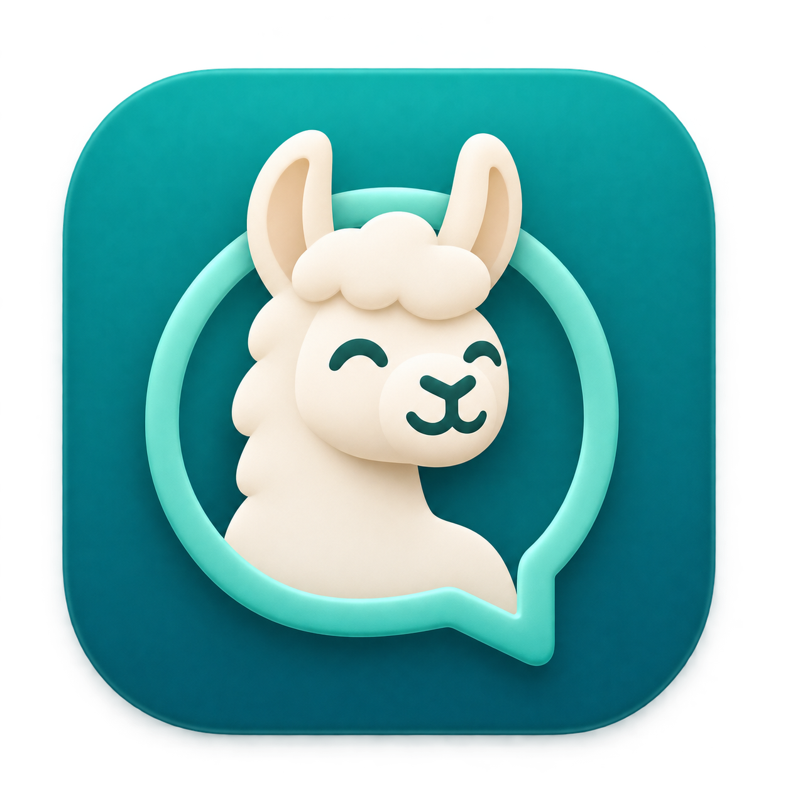

# Ollama Chat

A native macOS chat app built with SwiftUI for talking to models served by [Ollama](https://ollama.com). Choose an installed model, send a message, and watch the response stream into your conversation.

The default chat endpoint is `http://localhost:11434/api/chat`.



## Features

- Native SwiftUI interface with a conversation sidebar and model picker.
- Automatic discovery of installed Ollama models, with manual refresh.
- Streaming responses and a Stop button to cancel generation.
- Conversation history sent with each message for follow-up questions.
- Multiple conversations, saved automatically between launches.
- Markdown text rendering, selectable message text, and copy buttons.
- Expandable thinking output when the model returns it.
- Configurable Ollama chat endpoint and connection error messages.
- Support for macOS light and dark appearance.
- No third-party Swift package dependencies or app analytics.

## Requirements

- macOS 14 Sonoma or later.
- Xcode with a Swift 6.0 or later toolchain to compile the app. Select Xcode's command-line tools in **Xcode → Settings → Locations** if needed.
- Ollama running on your Mac, with at least one model installed.
- Enough memory and storage for your chosen model; requirements vary by model.

## Set up Ollama

1. Install [Ollama for macOS](https://ollama.com/download/mac) and launch it.
2. In Terminal, download a model. For example:

   ```sh
   ollama pull llama3.2
   ```

3. Confirm the server is available and lists your installed models:

   ```sh
   curl http://localhost:11434/api/tags
   ```

If you run Ollama from the command line instead of the macOS app, start the server with `ollama serve`. Keep it running while using Ollama Chat.

## Compile and run

Download this repository using GitHub's **Code → Download ZIP**, or clone it using the clone URL shown on GitHub. Open Terminal in the repository folder before running the commands below.

### Build a macOS app bundle

Run the included build script:

```sh
zsh scripts/build-app.sh
open "dist/Ollama Chat.app"
```

The script compiles a release build, creates `dist/Ollama Chat.app`, and signs it locally with an ad-hoc signature. You can also launch it from Finder or copy it into your Applications folder. This build is for local use; the script does not create a notarized distribution release.

The build also converts `Assets/AppIcon.png` into a macOS icon with standard and Retina sizes and includes it in the app bundle. To change the icon, replace that PNG with square artwork at least 1024 × 1024 pixels and rebuild. Icon conversion uses the macOS tools `sips` and `iconutil`; no additional dependencies are needed. The bundled icon applies to the packaged `.app` build.

### Run from Xcode

1. Open `Package.swift` in Xcode.
2. Select the **OllamaChat** scheme and **My Mac** as the run destination.
3. Choose **Product → Run** or press **Command-R**.

### Run with Swift Package Manager

For development, you can compile and launch the executable directly:

```sh
swift run OllamaChat
```

## Use the app

1. Start Ollama, then launch **Ollama Chat**.
2. Select an installed model from the picker at the top of the window. Use the refresh button after installing additional models.
3. Type a message and press **Return**, **Command-Return**, or the send arrow. Use **Shift-Return** to insert a new line.
4. Read the response as it streams. Select **Stop** to cancel generation; any text already received remains in the conversation.
5. Continue chatting to ask follow-up questions, or choose **New conversation** to start fresh.

Select a conversation in the sidebar to reopen it. Use a message's copy button to copy its answer, expand **Thinking** when available, or use the toolbar's trash button to delete the selected conversation. Conversation creation, switching, and deletion are disabled while a response is generating.

### Change the connection

Click the gear icon at the bottom of the sidebar, enter the full Ollama chat endpoint, and choose **Save & reconnect**. The app discovers models through `/api/tags` on the same server. For a standard local installation, keep:

```text
http://localhost:11434/api/chat
```

### Keyboard shortcuts

| Action | Shortcut |
| --- | --- |
| New conversation | Command-N |
| Send message | Return or Command-Return |
| Insert a new line | Shift-Return |

## Data storage and privacy

Conversations are stored as plain JSON on your Mac:

```text
~/Library/Application Support/OllamaChat/conversations.json
```

The endpoint and last-used model are stored in macOS user defaults. Each request sends the selected conversation's message history to the configured Ollama server. With the default endpoint, requests go to your local machine. If you configure another server, that server receives the conversation. Ollama and the selected model may have their own behavior and terms.

## Troubleshooting

| Problem | What to check |
| --- | --- |
| **Ollama unavailable** | Launch Ollama or run `ollama serve`, verify the endpoint in settings, then refresh models. |
| **No models installed** | Run `ollama pull llama3.2` (or install another model), then refresh. |
| Send button is disabled | Select a model and enter a message. Wait for generation to finish or select Stop. |
| Slow responses | Initial model loading can take time. Try a smaller model if memory is limited. |
| Swift or Xcode build errors | Check `swift --version` and `xcode-select -p`; use a Swift 6.0 or later toolchain with the macOS SDK. |

## Development

Run the unit tests from the repository folder:

```sh
swift test
```

The tests cover stream chunk decoding, endpoint validation, and chat message serialization. They do not require a running Ollama server.

| File | Purpose |
| --- | --- |
| `Sources/OllamaChat/OllamaChatApp.swift` | SwiftUI interface, chat state, and local conversation storage |
| `Sources/OllamaChat/OllamaClient.swift` | Model discovery and streaming chat requests |
| `Tests/OllamaChatTests/OllamaClientTests.swift` | Client unit tests |
| `scripts/build-app.sh` | Release compilation and app bundle packaging |
| `scripts/build-icon.sh` | Generate the macOS `.icns` icon from the source PNG |
| `Assets/AppIcon.png` | App icon artwork |

API references: [Ollama chat API](https://docs.ollama.com/api/chat) and [model listing API](https://docs.ollama.com/api/tags).
